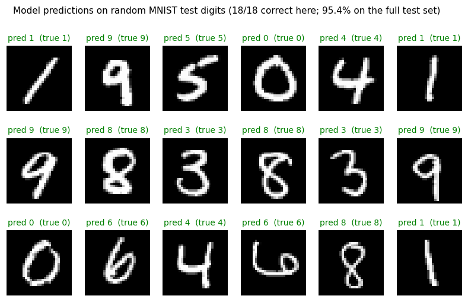

# MNIST Digit Classifier

A PyTorch neural network that recognises handwritten digits (0–9), with a small Tkinter canvas where you draw a digit and the model predicts it.



*Predictions of the saved model on random MNIST test digits.*

## Results

| Model | Test accuracy |
|---|---|
| MLP, 784 → 64 → 64 → 10 (ReLU), Adam (lr 0.0001), 10 epochs, batch size 32 | **95.4%** on the 10,000-image MNIST test set |

Test loss fell from 0.357 to 0.154 over the 10 epochs, and the accuracy was still rising, so more epochs or a CNN would do better. The trained weights are saved as `Mnist_number_detection.pth`.

## What's inside

`MNIST-Digit-Predictor/`
- `Mnist.ipynb` loads MNIST, wraps it in DataLoaders, defines the `MnistV1` model, trains and evaluates it, saves the weights, and ends with the drawing app.
- `Load_mnsit.ipynb` loads the saved weights and runs the drawing app, with no retraining.
- `Mnist_number_detection.pth` holds the trained weights.
- `helper_functions.py` is the `accuracy_fn` helper from the [Learn PyTorch](https://www.learnpytorch.io/) course, which I followed while learning.

## The drawing app

Draw a digit on a 280×280 black canvas with a white brush. Before prediction, the digit is cropped, centred with `scipy.ndimage` (centre of mass) and downscaled to 28×28 so that it looks like MNIST training data. Without the centring step, hand-drawn digits are often misclassified.

## Run it

```bash
pip install torch torchvision matplotlib tqdm scipy pillow notebook
jupyter notebook MNIST-Digit-Predictor/Load_mnsit.ipynb
```

`Mnist.ipynb` expects the dataset in `Mnist_dataset/`. Set `download = True` in the dataset cells to fetch it.

## Next steps
- Replace the MLP with a small CNN (expected to reach about 99%).
- Package the drawing app as a standalone `.py` script.

## Author
Shaikh Mohammad Hasnat, [GitHub](https://github.com/Shaikh-Mohammad-Hasnat), [LinkedIn](https://www.linkedin.com/in/shaikh-mohammad-hasnat-698a08335)
